## Vision for FSD

Vision-based path tracking and environment mapping for autonomous vehicles. Extracting important features from monocular frames for advanced driver assistance systems, and interpreting features from surround vision and lidar inputs.

**Implemented using geometry based feature extractors and open-sourced models. Not practically useful, more of a research oriented project.**

Part of a larger FSD research stack: [Monocular SLAM](https://github.com/gouthamk16/Slam) · [Environment Reasoning](https://github.com/gouthamk16/drive-vlm) · [DL Based Actuators](https://github.com/gouthamk16/xdrive)

The core idea of this project is to build an end-to-end perception model that leverages these features to predict driving trajectories and actuator-level control signals (steering angle, throttle input, and braking intensity etc) directly from sensor observations.

A major challenge in developing such systems is the massive amounts of annotated driving data required. Modern autonomous driving systems rely heavily on large-scale real-world data collection pipelines. For example, Tesla continuously gathers driving data from customer vehicles in real time, enabling iterative large-scale training and refinement of its Autopilot models (they call it "Fleet-Learning"). This continuous learning approach provides access to highly diverse driving scenarios and edge cases which significantly improves model generalization.

Research/Study on hardware required to run such systems [here](hardware.md)

The repo holds two independent pipelines:

| | [`fsd/`](fsd/) — active | [`monocular_vision/`](monocular_vision/) — legacy |
|---|---|---|
| Input | nuScenes: 6 surround cameras + LiDAR | a single dashcam video |
| Run | `python -m fsd.visualize` | `python main.py <video>` |

---

## 360 Vision - nuScenes

We work with the [nuScenes](https://www.nuscenes.org/) dataset, which has six surround-view cameras + LiDAR on a real autonomous vehicle. This lets us look in all directions at once and work with proper 3D sensor data instead of inferring depth from a single image.

nuScenes is organised as ~850 independent 20-second driving clips (called scenes), each with ~40 keyframes at 2 Hz. They're not continuous - scene 5 has nothing to do with scene 6 temporally or geographically, but each scene on its own is a clean, calibrated, fully-labelled snippet of real urban driving.

### What we can visualise

`fsd/visualize.py` is the single entry point for the whole nuScenes stack; every other module in `fsd/` is a library it calls.

| View | What it shows |
|---|---|
| `cameras` | All six cameras tiled into a contact sheet |
| `lidar` | LiDAR point cloud projected onto each camera image, coloured by depth |
| `bev` | Bird's-eye-view of the LiDAR sweep from above |
| `lss_bev` | Camera-only BEV vehicle prediction from Lift-Splat-Shoot, drawn on top of the nuScenes HD map |
| `lss_lidar_bev` | LSS prediction blended onto the LiDAR BEV for a direct sanity check |
| `occupancy_bev` | Temporal log-odds occupancy map fused across keyframes into a rolling world model |
| `height_bev` | 2.5D BEV tensor - per-cell point density and min/max/mean/range height channels |
| `objects_bev` | Camera+LiDAR frustum-fusion 3D detections on the LiDAR BEV |
| `objects_cameras` | The same fusion detections drawn back onto the six camera images |
| `world_bev` | Unified BEV world model: occupancy, height/collision context, ego state, object footprints, and per-object velocity arrows + predicted motion |
| `all` | All views rendered simultaneously |

### Camera-only BEV with Lift-Splat-Shoot

The six surround cameras alone are enough to estimate a top-down vehicle occupancy map. We integrate NVIDIA's [Lift-Splat-Shoot](https://github.com/nv-tlabs/lift-splat-shoot) (ECCV 2020): each camera image is lifted into a per-pixel depth distribution, splat into a shared ego-frame voxel grid, and decoded into a BEV vehicle segmentation. The pretrained checkpoint runs without finetuning, and we render the output on top of the nuScenes HD map expansion pack (includes lanes, road outlines, lane lines etc). Implementation in [fsd/lss.py](fsd/lss.py) and [fsd/nuscenes_map.py](fsd/nuscenes_map.py).

### Temporal occupancy - from per-frame perception to a world model

Everything above is per-frame: process a sweep, draw it, move on. The occupancy view makes the system stateful. We keep a rolling log-odds grid in the ego frame, and each keyframe we warp the previous grid into the new ego frame using the nuScenes ego poses, decay it slightly, then fold in fresh LiDAR evidence - cells holding above-ground returns are occupied, and every cell a laser ray crosses before its first obstacle is free. The result is a continuously evolving map of free space and obstacles instead of a single-frame snapshot - the drivable corridor trailing behind the ego is evidence accumulated over the whole scene. This is the classical, debuggable groundwork for downstream trajectory planning. Implementation in [fsd/occupancy.py](fsd/occupancy.py).

### 2.5D height channels - a richer BEV tensor

The plain BEV only knows "cell has points or not." The height tensor keeps the vertical information instead of throwing it away: for every cell we record point density and the min, max, mean, and range of the LiDAR heights that landed there. `height_range` (max - min) is the useful one - flat road is near zero, cars and walls are large - so it separates drivable surface from obstacles with pure geometry, no labels. This is the data structure downstream modules (planning, lane fitting, the object layer) read instead of re-rasterizing raw points. Implementation in [fsd/bev_tensor.py](fsd/bev_tensor.py).

### Unified BEV world model

The world model combines the separate BEV layers into one state object: temporal occupancy probability, 2.5D LiDAR height channels, collision cells, ego speed/state, and object footprints from GT boxes or detector predictions. This is the handoff point between perception and planning. Implementation in [fsd/world_model.py](fsd/world_model.py).

### Object velocity + short-horizon prediction

Up to here the world model only knew *where* other cars and people were - a frozen snapshot. This layer adds **how fast each one is moving, which way, and where it will be in the next few seconds**.

Each tracked object carries a small Kalman filter with a constant turn-rate and velocity (CTRV) motion model: it keeps a running estimate of position, heading, speed and turn rate, and every new sighting nudges that estimate rather than replacing it. Dividing the distance between two noisy snapshots by the time between them, which is what this layer did first, turns half a metre of detector wobble into a metre per second of fake speed; the filter averages it out. It also predicts along a curve when the object is turning, and keeps a track alive through a missed detection or two. Implementation in [fsd/ekf.py](fsd/ekf.py).

The only hard part is knowing which object in this frame is the *same* object from the last frame. We do it two ways:

- **The answer-key way** (`GtVelocityTracker`): the nuScenes dataset labels every object with a permanent ID, so the match is perfect. This is our gold standard. Drawn in amber.
- **The real way** (`PredictionVelocityTracker`): our CenterPoint detector gives no IDs, so we match each detection to the nearest track of the same type (car, truck, ...), measured from where the filter predicts that track to be now. Drawn in orange.

When we check the real way against the answer key on scene 0, the median velocity difference is **0.18 m/s** (it was 0.42 m/s with the two-snapshot difference), so tracking real detections works nearly as well as the labelled baseline. The planner view uses the same tracker on the NMP's detections. In the `world_bev` view each moving object gets an arrow (where it is heading), a faint outline (where it will be in 3 seconds), and a speed tag like `5.2 m/s`. Pass `--predictions` to also show the detector's version. Implementation in [fsd/tracking.py](fsd/tracking.py).

### Neural motion planner

A learned planner after [Zeng et al., CVPR 2019](https://arxiv.org/abs/2101.06679). One convolutional network reads 10 LiDAR sweeps and 8 HD-map layers on a 140.8 x 80 m grid and outputs two things: vehicle detections with 3 s forecasts, and a **cost volume** - one cost map per future half second. Planning samples 1000 physically plausible trajectories (straight lines, circles and clothoids) and picks the one with the lowest summed cost. Nobody hand-writes the cost: training only says that the driven trajectory must be cheaper than every sampled one, by a margin that grows when the sample collides with a vehicle or leaves the road.

Trained 20 epochs on 139 nuScenes train scenes (4,396 samples), evaluated on the 31 official val scenes we have (983 samples). Collision and off-road rates are cumulative up to each horizon:

| method | L2 1/2/3 s (m) | collision 1/2/3 s (%) | off-road 3 s (%) |
|---|---|---|---|
| human driver (logged) | 0 / 0 / 0 | 0.00 / 0.00 / 0.00 | 0.00 |
| constant velocity | 0.40 / 1.16 / 2.33 | 0.00 / 0.41 / 2.24 | 5.70 |
| **NMP, last epoch** | 0.49 / 1.65 / 3.60 | 0.00 / 0.10 / 1.02 | 0.00 |
| NMP, best epoch by val collision (13) | 0.49 / 1.65 / 3.60 | 0.00 / 0.00 / 0.61 | 0.00 |
| NMP reference ([Khurana et al., ECCV 2022](https://arxiv.org/abs/2210.01917), full val, no map) | 0.53 / 1.25 / 2.67 | 0.04 / 0.12 / 0.87 | - |

The last epoch is the honest number; the best epoch was picked on the same val split, so its collision rate is optimistic. The planner stays on the road and out of other cars far better than driving straight (the human row shows the metrics don't penalise normal driving), and it travels 17.5 m in 3 s against the human's 19.2 m, so it is not avoiding collisions by stopping. It is further from the human trajectory than both constant velocity and the reference. The reference uses the same loss, so the loss alone doesn't explain that; less data (a fifth of nuScenes, 31 of 150 val scenes) and the differences between our setup and theirs are candidates, not a diagnosis. Vehicle AP at 2 m is 0.45, scored like the nuScenes detection eval: vehicles within 50 m that LiDAR actually hit and that lie inside the model's grid. Implementation in [fsd/nmp/](fsd/nmp/).

### Results

<table>
  <tr>
    <td width="50%" align="center">
      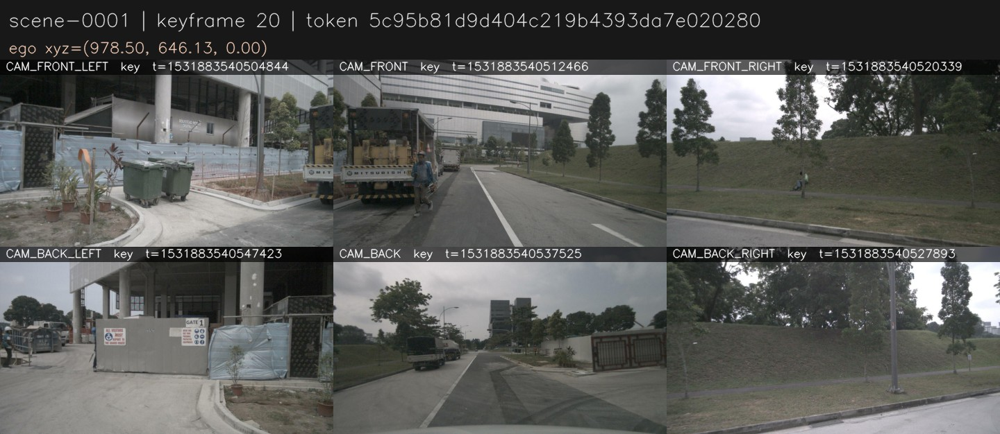<br>
      <sub>Six surround cameras tiled into a contact sheet</sub>
    </td>
    <td width="50%" align="center">
      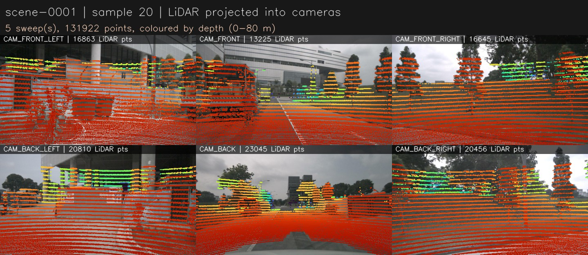<br>
      <sub>LiDAR projected onto the camera images, coloured by depth</sub>
    </td>
  </tr>
  <tr>
    <td width="50%" align="center">
      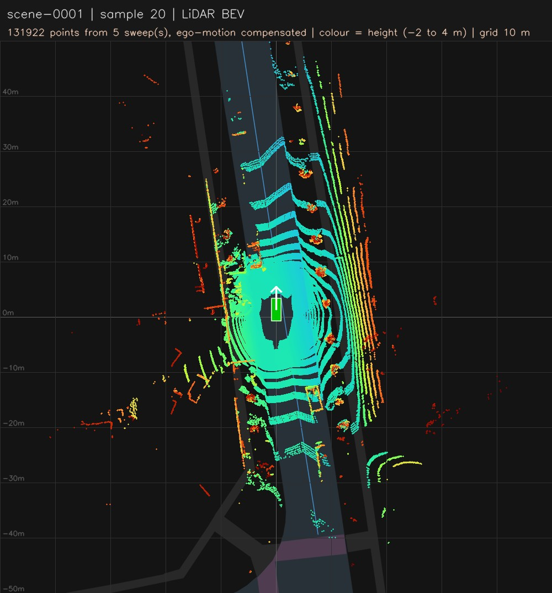<br>
      <sub>LiDAR BEV - 5 ego-motion-compensated sweeps over the HD map, coloured by height</sub>
    </td>
    <td width="50%" align="center">
      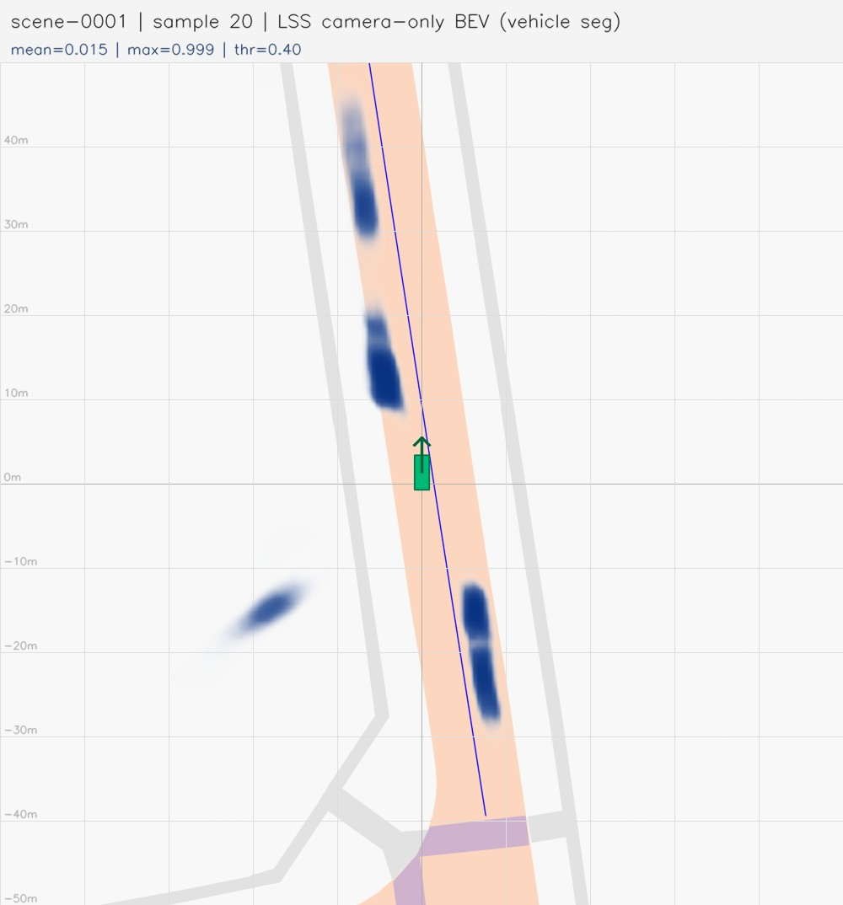<br>
      <sub>Lift-Splat-Shoot camera-only vehicle BEV on the HD map (singapore-onenorth)</sub>
    </td>
  </tr>
  <tr>
    <td width="50%" align="center">
      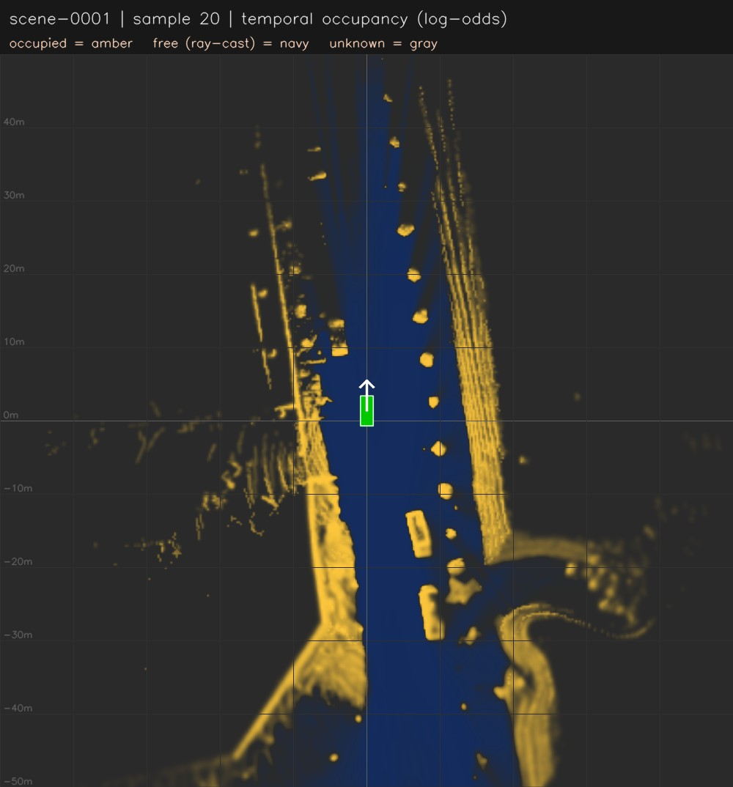<br>
      <sub>Temporal occupancy - log-odds fused across a scene, free space ray-cast (amber=occupied, navy=free, gray=unknown)</sub>
    </td>
    <td width="50%" align="center">
      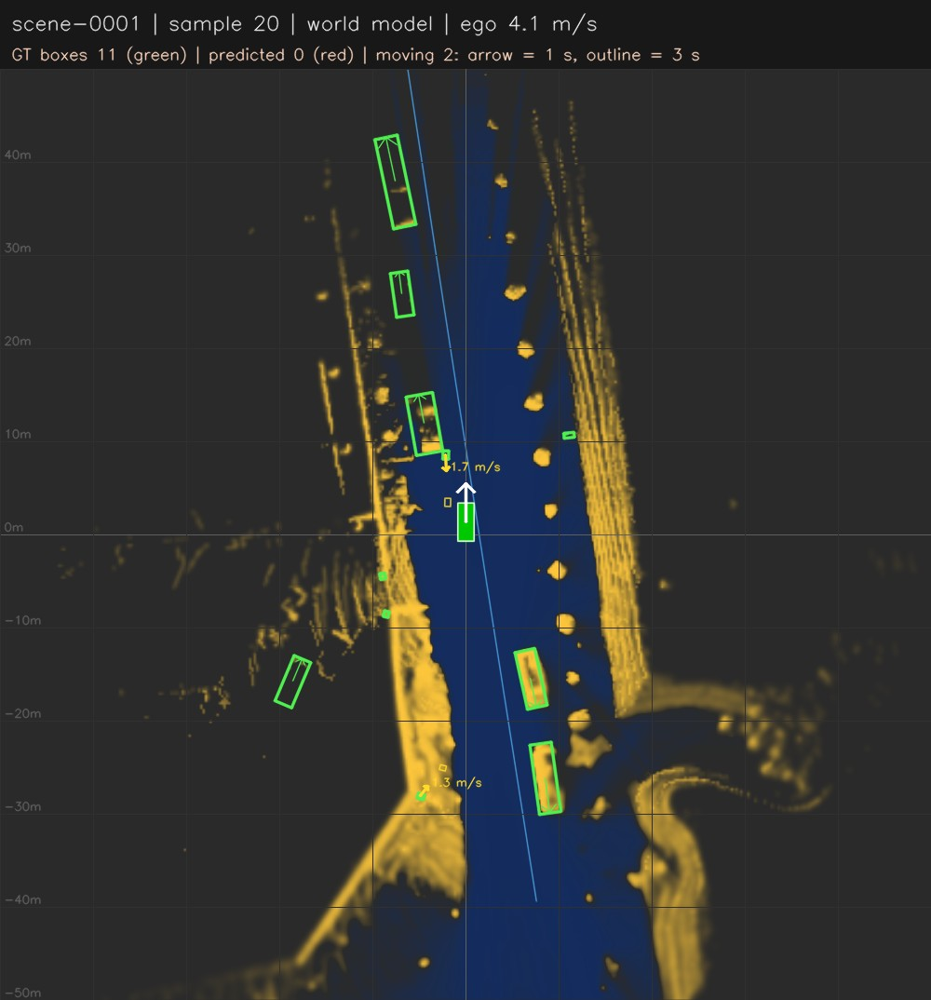<br>
      <sub>Unified BEV world model - occupancy, map lane lines, ego state, GT object footprints, and per-object velocity (arrows = 1 s, outlines = 3 s ahead)</sub>
    </td>
  </tr>
  <tr>
    <td colspan="2" align="center">
      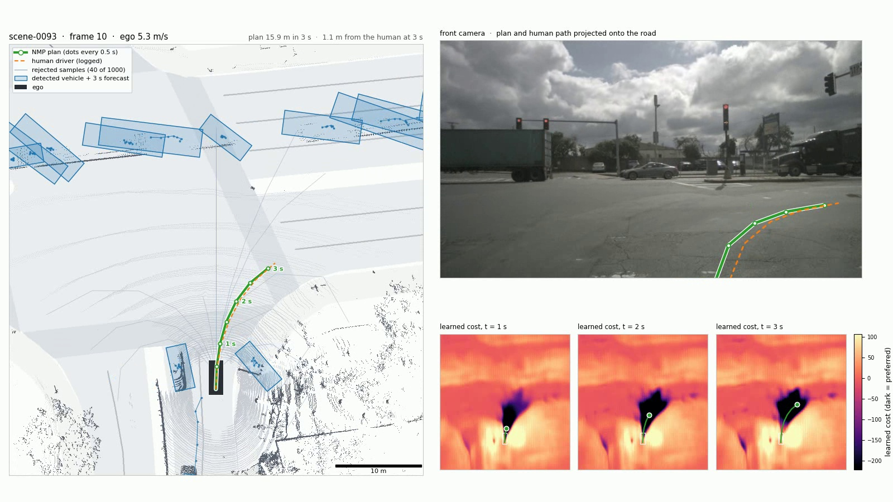<br>
      <sub>Neural motion planner on an unseen val scene (right turn, 10 Hz) - left: the chosen 3 s plan (green) against what the human actually drove (orange, dashed), rejected samples (light blue) and detected vehicles with 3 s forecasts (blue); right: both paths projected into the front camera, and the learned cost the plan minimises at 1, 2 and 3 s (dark = preferred)</sub>
    </td>
  </tr>
  <tr>
    <td colspan="2" align="center">
      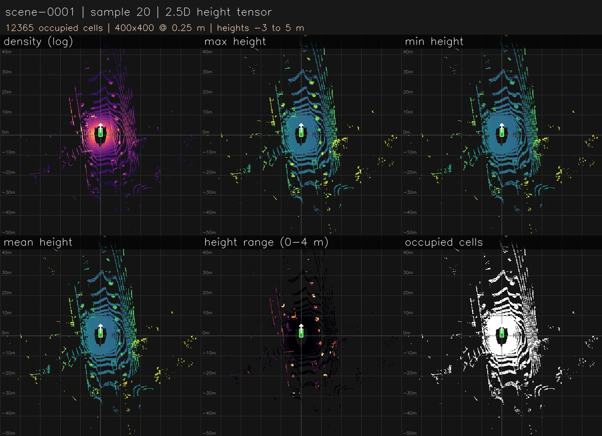<br>
      <sub>2.5D BEV tensor - per-cell point density and min/max/mean/range height channels (one panel each)</sub>
    </td>
  </tr>
</table>

### Run

```bash
# Single scene, default 20 keyframes
python -m fsd.visualize --view cameras --save

# All frames in a scene
python -m fsd.visualize --view lidar --frames all --save

# Stitch scenes 0 through 9 into one video
python -m fsd.visualize --scenes 0-9 --frames all --view cameras --save

# Stream all views at once
python -m fsd.visualize --view all --frames all --stream

# Unified BEV world model
python -m fsd.visualize --view world_bev --frames 40 --save

# Denser LiDAR: accumulate 10 ego-motion-compensated sweeps per keyframe
python -m fsd.visualize --view bev --lidar-sweeps 10 --save

# Smoother video using raw camera sweeps (~12 Hz instead of 2 Hz keyframes)
python -m fsd.visualize --view cameras --sequence sweeps --frames all --save
```

Neural motion planner - build the sample cache once, train, evaluate, then view:

```bash
python -m fsd.nmp.train cache --split val      # ~2 min
python -m fsd.nmp.train cache --split train    # ~9 min, ~1 GB in ~/.cache/vision-fsd/nmp
python -m fsd.nmp.train fit                    # 20 epochs, ~3 h on an 8 GB laptop GPU
python -m fsd.nmp.train fit --resume           # continue after an interruption
python -m fsd.nmp.train eval --weights checkpoints/nmp/best.pt
python -m fsd.visualize --view planner_bev --nmp-weights checkpoints/nmp/best.pt --scene-name scene-0003 --save

# Plan at 10 Hz on LiDAR sweeps instead of 2 Hz keyframes, over five consecutive val scenes (~100 s)
python -m fsd.visualize --view planner_bev --nmp-weights checkpoints/nmp/best.pt --sequence sweeps --scenes 75-79 --frames all --fps 10 --save
```

nuScenes data is read from `C:/nuscenes` (override with `--dataroot` or `NUSCENES_ROOT`). Extract the official archives straight into that root, which gives the flat devkit layout:

```text
<dataroot>/
  samples/          # keyframe images + LiDAR  (from v1.0-trainvalNN_blobs.tgz)
  sweeps/           # intermediate sweeps      (from v1.0-trainvalNN_blobs.tgz)
  maps/expansion/   # HD map JSON              (nuScenes-map-expansion-v1.3.zip)
  v1.0-trainval/    # metadata tables          (v1.0-trainval_meta.tgz)
```

The metadata covers all 850 scenes, but only scenes whose blobs are extracted are listed, so `--scenes 0` is the first scene you actually have. On first run the loader streams the large metadata tables once and caches a compact index in `~/.cache/vision-fsd/`; later runs start in seconds, and extracting another blob part rebuilds the index automatically.

---

## Monocular vision extractor - legacy

This was the original single-camera pipeline, kept because it still runs. Active work happens on the nuScenes stack above.

Each video frame is passed through four subsystems running in sequence:

| Subsystem | Model | Output |
|---|---|---|
| Object detection + tracking | YOLOv2.6 + ByteTrack | 2D bounding boxes with locked class labels and per-object distance |
| Monocular depth estimation | DepthAnything V2 (metric outdoor) | Per-pixel depth map in metres |
| Drivable area segmentation | YOLOPv2 | Binary pixel mask separating drivable road from non-drivable regions |
| Visual odometry | SIFT + FLANN + Essential matrix | Camera pose and trajectory |

Depth and segmentation outputs are fused in the final render: the drivable area is overlaid as a green tint on the frame, detected vehicles get per-object distance labels from the depth map, and everything is summarised in a bird's-eye-view (BEV) minimap covering ~83 m forward range.

<table>
  <tr>
    <td width="50%" align="center">
      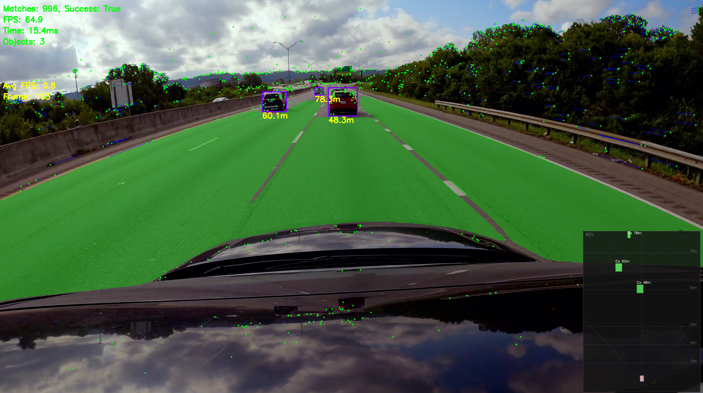<br>
      <sub>Detection + drivable-area segmentation + BEV minimap</sub>
    </td>
    <td width="50%" align="center">
      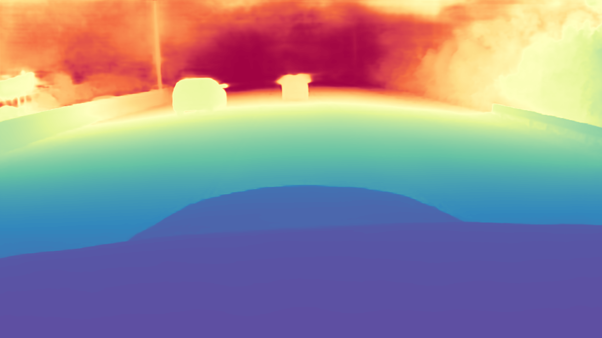<br>
      <sub>Monocular depth estimation (a different frame)</sub>
    </td>
  </tr>
  <tr>
    <td width="50%" align="center">
      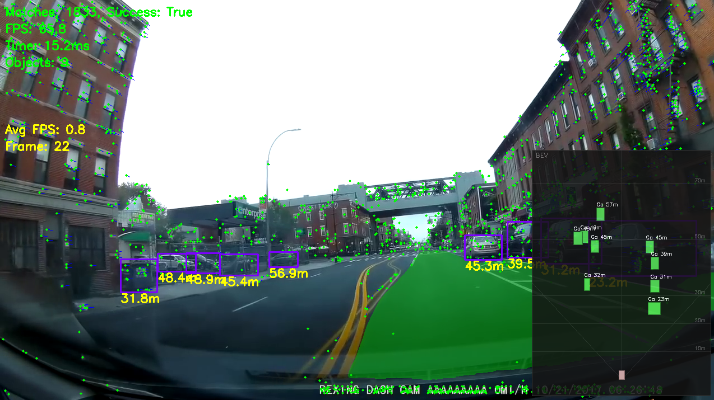<br>
      <sub>Understands double yellow lines - only the current lane is marked drivable</sub>
    </td>
    <td width="50%"></td>
  </tr>
</table>

### Run

```bash
# Stream processed output to screen
python main.py data/your_video.mp4 --stream

# Save annotated video to outputs/
python main.py data/your_video.mp4 --save

# Limit to first N frames (useful for quick tests)
python main.py data/your_video.mp4 --stream --frames 300

# Full options
python main.py --help
```

Place a dashcam video under `data/` and pass the path at runtime. Outputs land in `outputs/`, logs in `logs/`; `LOGGING_LEVEL` sets verbosity.

---

## Requirements

- Python 3.12
- CUDA-capable GPU (tested on RTX 4060, CUDA 12.8)

## Setup

```bash
git clone <this-repo>
cd vision-fsd
python -m venv .venv
# Windows
.venv\Scripts\activate
# Linux / macOS
source .venv/bin/activate
```

Install the CUDA 12.8 PyTorch build first, since `requirements.txt` pins the `+cu128` variants:

```bash
pip install torch torchvision --index-url https://download.pytorch.org/whl/cu128
pip install -r requirements.txt
```

`fsd/centerpoint_export.py` is deliberately not covered by `requirements.txt` — it needs mmdet3d against torch 2.1/cu121 and runs in its own `.venv-mmdet3d`.

## Tests

```bash
pytest tests/
```

Covers the data layer, BEV geometry, occupancy, tracking, detection geometry, the map renderer, view selection, and the neural motion planner (sampler, samples, dataset, model, losses, metrics and a small overfit run of training). No GPU or dataset needed.

## Models

| File | Size | Source |
|---|---|---|
| `yolo26n.pt` | ~6 MB | Not tracked (`*.pt` is gitignored). Ultralytics fetches it on first use; otherwise place it at the repo root |
| `yolopv2.pt` | ~70 MB | Auto-downloaded from GitHub releases on first run |
| DepthAnything V2 (metric outdoor large) | ~335 MB | Auto-downloaded from HuggingFace on first run |
| Lift-Splat-Shoot BEV vehicle seg (`model525000.pt`) | ~55 MB | Manual: [Google Drive](https://drive.google.com/file/d/1bsUYveW_eOqa4lglryyGQNeC4fyQWvQQ/view?usp=sharing), drop into `models/` and pass via `--lss-weights` |
| Neural motion planner (`checkpoints/nmp/best.pt`) | ~40 MB | Trained locally with `python -m fsd.nmp.train fit`; pass via `--nmp-weights` |

## Todo

- Extended Kalman filters for trajectory mapping and path tracking (design and plan in `docs/superpowers/`)
- Lane detection (probably using a pretrained model, training a lane det model today is useless)
